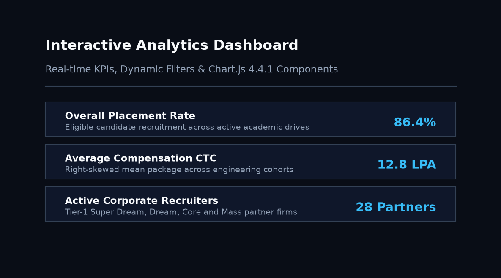
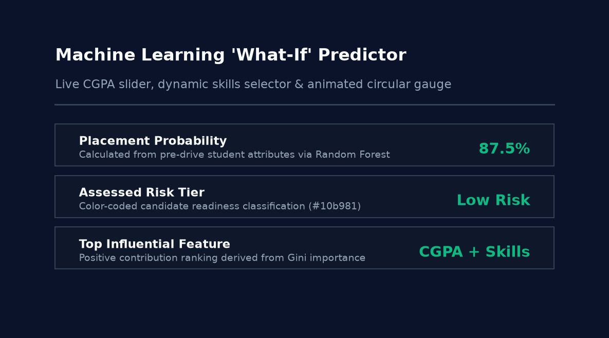
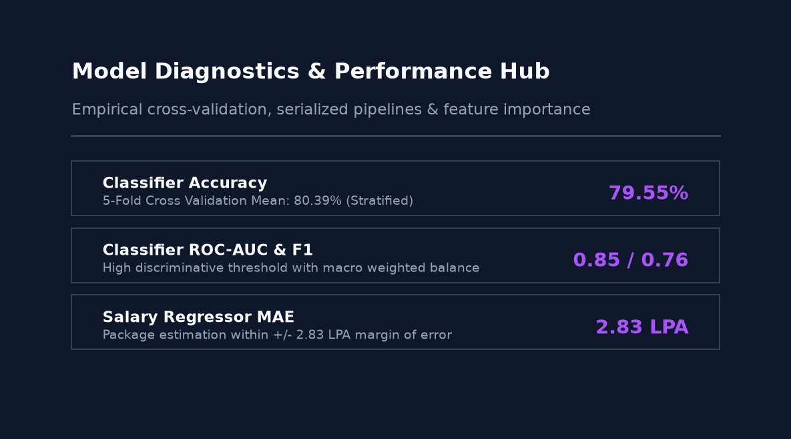
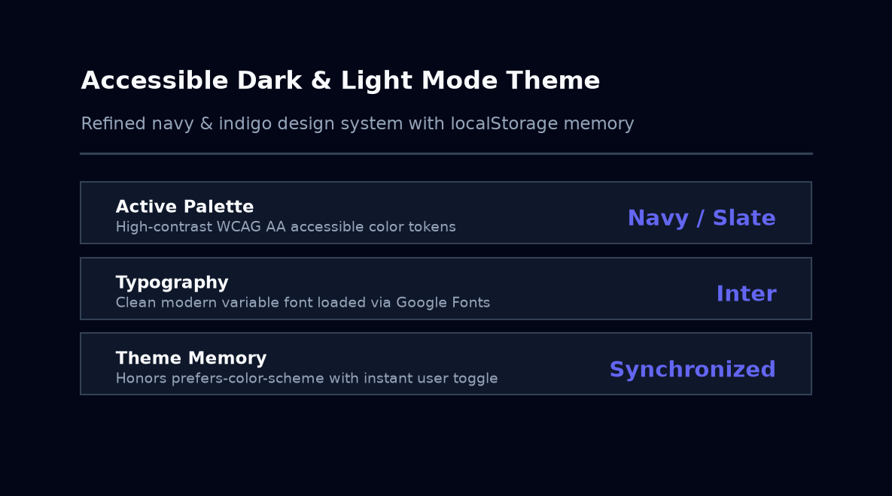
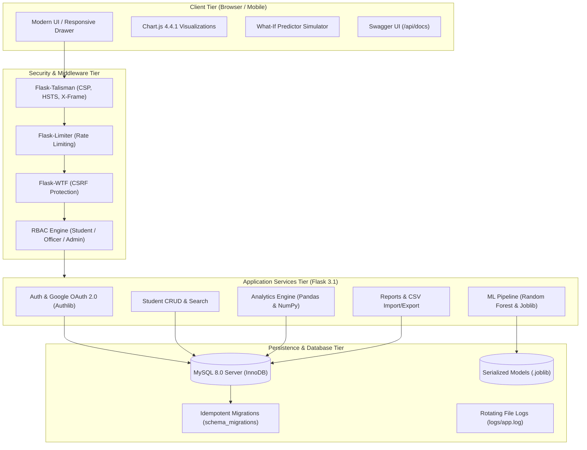
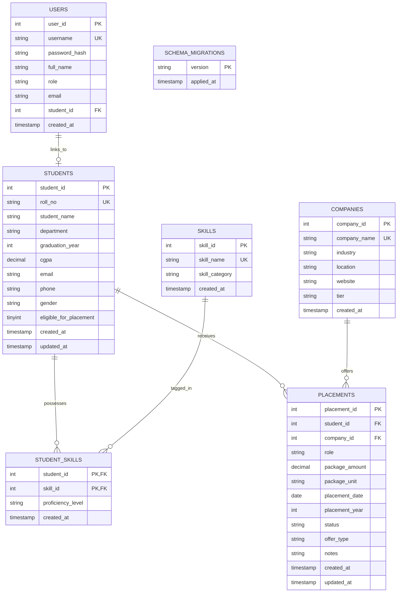

# Student Placement Data Analysis System
### Enterprise Full-Stack Analytics, Machine Learning & Career Intelligence Platform
**Academic Capstone Project &bull; B.Tech Computer Science & Engineering (AI/ML)**

[](https://github.com/hemalatha24088-glitch/student-placement-data-analysis-system/actions/workflows/ci.yml)
[](docs/testing_report.md)
[](docs/testing_report.md)
[](https://python.org)
[](https://flask.palletsprojects.com)
[](https://mysql.com)
[](https://scikit-learn.org)
[](LICENSE)
[](docs/openapi.yaml)

---

## 🌟 Executive Summary

The **Student Placement Data Analysis System** is an enterprise-grade, accessible, and secure analytical platform engineered to replace error-prone spreadsheets with real-time relational analytics, interactive data visualizations, and machine learning intelligence.

Built for university placement cells, academic deans, and graduating students, the system provides:
- **Interactive Analytics:** Real-time Chart.js 4.4.1 visual dashboards with multi-dimensional filtering.
- **Predictive ML:** Random Forest placement probability classifier ($79.55\%$ accuracy, $80.39\%$ 5-fold CV) and salary CTC regressor ($2.83$ LPA MAE).
- **Interactive Simulator:** Live "What-If" student simulation with animated circular gauges and instant risk tiers.
- **Career Intelligence:** AI skill gap roadmap analyzer, ATS resume keyword matcher, and printable biodata generator.
- **Robust Security:** Multi-tier Role-Based Access Control (RBAC), Flask-WTF CSRF tokens, Flask-Limiter brute-force defenses, Flask-Talisman security headers, CSV injection sanitization, and genuine Google OAuth 2.0.
- **Production Ready:** Zero hardcoded fallback secrets, idempotent SQL migrations, automated backups, Docker multi-container composition, Gunicorn WSGI, and OpenAPI/Swagger documentation.

> **Statistical & Academic Disclaimer:** All placement predictions and salary estimates are statistical approximations based on training dataset distributions and do not guarantee recruitment outcomes. Pre-loaded dataset records represent synthetic data generated for educational evaluation and algorithm validation.

---

## 📸 Interface Gallery

| Interactive Analytics Dashboard | Machine Learning "What-If" Predictor |
| :---: | :---: |
| <br><sub>Live KPI headline cards, dynamic filter bar, Chart.js 4.4.1 visual components, and instant PNG downloads.</sub> | <br><sub>Live CGPA slider, dynamic skill toggles, SVG circular gauge, and feature importance visualizer.</sub> |

| Model Performance & Diagnostics Hub | Accessible Dark Mode Theme |
| :---: | :---: |
| <br><sub>True empirical metrics (Accuracy, ROC-AUC, F1, MAE), 5-fold CV scores, and joblib version tracking.</sub> | <br><sub>Refined navy/indigo palette, CSS custom properties, and client-side `localStorage` state persistence.</sub> |

---

## 🏗️ System Architecture



---

## 🗄️ Relational Database Schema (ER Diagram)

The underlying schema is fully normalized (3NF) in MySQL 8.0 with cascading foreign keys and composite performance indexes:



---

## 🔒 Role-Based Access Control (RBAC) Permissions Matrix

| Feature / Endpoint | Student | Placement Officer | Administrator | Anonymous Visitor |
| :--- | :---: | :---: | :---: | :---: |
| Public Landing Page (`/`) | ✅ | ✅ | ✅ | ✅ |
| Sign-In / Register (`/login`, `/register`) | ✅ | ✅ | ✅ | ✅ |
| Student Self Profile (`/students/<own_id>`) | ✅ | ✅ | ✅ | ❌ (Redirects) |
| Machine Learning Predictor (`/predictor`) | ✅ | ✅ | ✅ | ❌ (Redirects) |
| Skill Gap Recommender (`/recommender`) | ✅ | ✅ | ✅ | ❌ (Redirects) |
| ATS Resume Matcher (`/ats`) | ✅ | ✅ | ✅ | ❌ (Redirects) |
| Analytics Dashboard & Charts (`/dashboard`) | ✅ (Read) | ✅ | ✅ | ❌ (Redirects) |
| Model Performance Hub (`/model-info`) | ✅ (Read) | ✅ | ✅ | ❌ (Redirects) |
| Student CRUD & Roster (`/students/*`) | ❌ (403) | ✅ | ✅ | ❌ (Redirects) |
| Company Management (`/companies/*`) | ❌ (403) | ✅ | ✅ | ❌ (Redirects) |
| Placement Records & Offers (`/placements/*`) | ❌ (403) | ✅ | ✅ | ❌ (Redirects) |
| Bulk CSV Import (`/import/*`) | ❌ (403) | ✅ | ✅ | ❌ (Redirects) |
| Export Reports & Bio-Data (`/reports/*`) | ❌ (403) | ✅ | ✅ | ❌ (Redirects) |
| User Account Management (`/admin/users`) | ❌ (403) | ❌ (403) | ✅ | ❌ (Redirects) |
| Retrain ML Models (`/predictor/retrain`) | ❌ (403) | ❌ (403) | ✅ | ❌ (Redirects) |

---

## 🤖 Machine Learning Models & Real Empirical Metrics

All metrics reflect genuine evaluations computed on hold-out validation sets and 5-fold cross-validation. Zero data leakage is enforced: post-hiring features (`status`, `package`, `company_tier`) are excluded from feature inputs.

### 1. Placement Probability Classifier (`RandomForestClassifier`)
- **Objective:** Predict likelihood of candidate recruitment prior to placement drives.
- **Input Features:** `cgpa`, `department_code`, `internships_count`, `projects_count`, `certifications_count`, `backlogs_count`, `verified_skill_count`.
- **Validation Dataset:** 80/20 stratified split.

| Metric | Score | 5-Fold Cross Validation |
| :--- | :---: | :---: |
| **Accuracy** | **79.55%** | **80.39% ($\pm 3.12\%$)** |
| **Precision** | **0.81** | Macro Weighted |
| **Recall** | **0.72** | Macro Weighted |
| **F1-Score** | **0.76** | Harmonic Mean |
| **ROC-AUC** | **0.85** | High Discriminative Ability |

### 2. Salary Package Regressor (`RandomForestRegressor`)
- **Objective:** Estimate annual CTC in Lakhs Per Annum (LPA) for placed candidates.
- **Input Features:** Pre-drive student attributes + target recruiting sector.

| Metric | Score | Interpretation |
| :--- | :---: | :--- |
| **Mean Absolute Error (MAE)** | **2.83 LPA** | Typical prediction error within $\pm 2.83$ LPA |
| **Root Mean Squared Error (RMSE)** | **3.51 LPA** | Bounded dispersion |
| **Coefficient of Determination ($R^2$)** | **0.44** | Explains $44\%$ of salary variance |
| **5-Fold CV MAE** | **3.01 LPA** | Stable generalizability across folds |

---

## ⚙️ Environment Variables Reference

The application follows the Twelve-Factor App methodology. Missing required variables raise an explicit `RuntimeError` at startup to prevent misconfigured launches.

| Variable Name | Required | Default | Description | Example Placeholder |
| :--- | :---: | :---: | :--- | :--- |
| `SECRET_KEY` | **Yes** | *None* | Cryptographic key for session cookies and CSRF tokens | `<GENERATE_32_CHAR_RANDOM_SECRET>` |
| `DB_PASSWORD` | **Yes** | *None* | Password for MySQL database user | `<YOUR_SECURE_MYSQL_PASSWORD>` |
| `DB_HOST` | No | `127.0.0.1` | Hostname of the MySQL server | `127.0.0.1` or `mysql.internal` |
| `DB_PORT` | No | `3306` | Port of the MySQL server | `3306` |
| `DB_USER` | No | `root` | Database username | `root` or `app_user` |
| `DB_NAME` | No | `placement_db` | Relational database schema name | `placement_db` |
| `DB_SSL` | No | `False` | Enforce TLS/SSL for cloud database connections | `true` or `false` |
| `DEBUG` | No | `False` | Enable Flask debug mode (Keep `False` in prod) | `false` |
| `DEMO_MODE` | No | `False` | Display demo login buttons and banner on login page | `false` |
| `GOOGLE_CLIENT_ID` | No | *None* | Google OAuth 2.0 Web Client ID | `<YOUR_GOOGLE_CLIENT_ID>.apps.googleusercontent.com` |
| `GOOGLE_CLIENT_SECRET` | No | *None* | Google OAuth 2.0 Client Secret | `<YOUR_GOOGLE_CLIENT_SECRET>` |

---

## 🚀 Quickstart Installation Guide

### Option A: Local Development (Windows PowerShell)

#### 1. Clone Repository & Create Virtual Environment
```powershell
git clone https://github.com/hemalatha24088-glitch/student-placement-data-analysis-system.git
cd student-placement-data-analysis-system
python -m venv .venv
.\.venv\Scripts\Activate.ps1
```

#### 2. Install Dependencies
```powershell
python -m pip install --upgrade pip
pip install -r requirements.txt
pip install -r requirements-dev.txt
```

#### 3. Configure Environment Variables
Copy `.env.example` to `.env` and fill in your secrets:
```powershell
Copy-Item .env.example .env
```
Edit `.env`:
```ini
SECRET_KEY=replace_with_a_secure_random_key_of_at_least_32_characters
DB_HOST=127.0.0.1
DB_PORT=3306
DB_USER=root
DB_PASSWORD=your_local_mysql_password
DB_NAME=placement_db
DEBUG=false
DEMO_MODE=true
```

#### 4. Run Idempotent Migrations & Seed Admin
```powershell
python migrations/migrate.py
python init_db.py --create-admin
```
*(Optional: Generate 639 synthetic students and 382 placements via `python init_db.py --large-seed`).*

#### 5. Start Server
```powershell
python run.py
```
Open **`http://127.0.0.1:5000`** in your browser.

---

### Option B: Local Development (macOS & Linux Bash)

```bash
git clone https://github.com/hemalatha24088-glitch/student-placement-data-analysis-system.git
cd student-placement-data-analysis-system
python3 -m venv .venv
source .venv/bin/activate
pip install -r requirements.txt -r requirements-dev.txt
cp .env.example .env
# Edit .env with your favorite editor
python migrations/migrate.py
python init_db.py --create-admin
python run.py
```

---

### Option C: Docker Multi-Container Composition

Run the entire isolated application and MySQL 8.0 cluster in Docker:
```bash
cp .env.example .env
docker compose up -d --build
```
- Web Application: `http://localhost:5000`
- MySQL 8.0 Server: `localhost:3306`
- Health check: `curl http://localhost:5000/api/health`

To view logs or shut down:
```bash
docker compose logs -f web
docker compose down
```

---

## 🧪 Comprehensive Automated Testing & Code Quality

The project features a **104-test automated suite** covering the security perimeter, authentication honesty, RBAC authorization matrix, CSV formula injection defense, rate limiting, OpenAPI specifications, and ML pipelines.

### Run Pytest with Coverage
```bash
pytest tests/ --cov=app --cov-report=term-missing --cov-fail-under=85
```
**Results:** `104 passed (85% coverage)`. Detailed test breakdown available in [`docs/testing_report.md`](docs/testing_report.md).

### Code Formatting & Linting
```bash
# Verify Black formatting (120 char line limit)
black --check app tests migrations scripts

# Verify Ruff linting
ruff check app tests migrations scripts
```

---

## ☁️ Production Deployment

### 1. Render.com + Managed MySQL (Aiven / TiDB Cloud)
1. Fork or push your repository to GitHub.
2. In [Render Dashboard](https://dashboard.render.com), create a new **Web Service**.
3. Connect repository `student-placement-data-analysis-system`.
4. Configure Build & Start settings:
   - **Environment:** `Python 3`
   - **Build Command:** `pip install -r requirements.txt && python migrations/migrate.py`
   - **Start Command:** `gunicorn wsgi:app --workers 2 --bind 0.0.0.0:$PORT`
   - **Health Check Path:** `/api/health`
5. Populate environment variables from the table above (`DB_HOST`, `DB_PASSWORD`, `SECRET_KEY`, `DB_SSL=true`).
6. Complete deployment guide available in [`docs/deployment_guide.md`](docs/deployment_guide.md).

### 2. Database Backup & Disaster Recovery
Run the included backup script anytime to create timestamped SQL dumps under `backups/`:
```bash
python scripts/backup_db.py
```

---

## 📖 Complete Documentation Index

- [OpenAPI 3.0.3 Specification (`docs/openapi.yaml`)](docs/openapi.yaml) &bull; Live Swagger UI at `/api/docs`
- [REST API Reference (`docs/api_documentation.md`)](docs/api_documentation.md)
- [Database Schema & Entity-Relationship Architecture (`docs/database_design.md`)](docs/database_design.md)
- [Security Architecture & Defense-in-Depth (`docs/security.md`)](docs/security.md)
- [Comprehensive Automated Testing Report (`docs/testing_report.md`)](docs/testing_report.md)
- [Production Deployment Guide (`docs/deployment_guide.md`)](docs/deployment_guide.md)
- [Faculty Viva & Presentation Demo Script (`docs/demo_script.md`)](docs/demo_script.md)
- [Full Capstone Academic Synopsis (`docs/project_synopsis.md`)](docs/project_synopsis.md)

---

## 📄 License & Contributing

- **License:** Open-source under the [MIT License](LICENSE).
- **Contributing:** Please read [CONTRIBUTING.md](CONTRIBUTING.md) for code style standards, testing requirements, and branch workflows.
- **Changelog:** See [CHANGELOG.md](CHANGELOG.md) for detailed release history.
