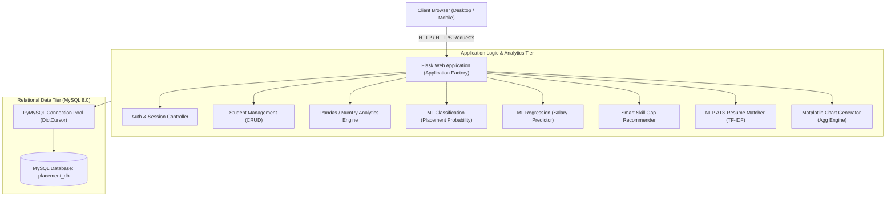
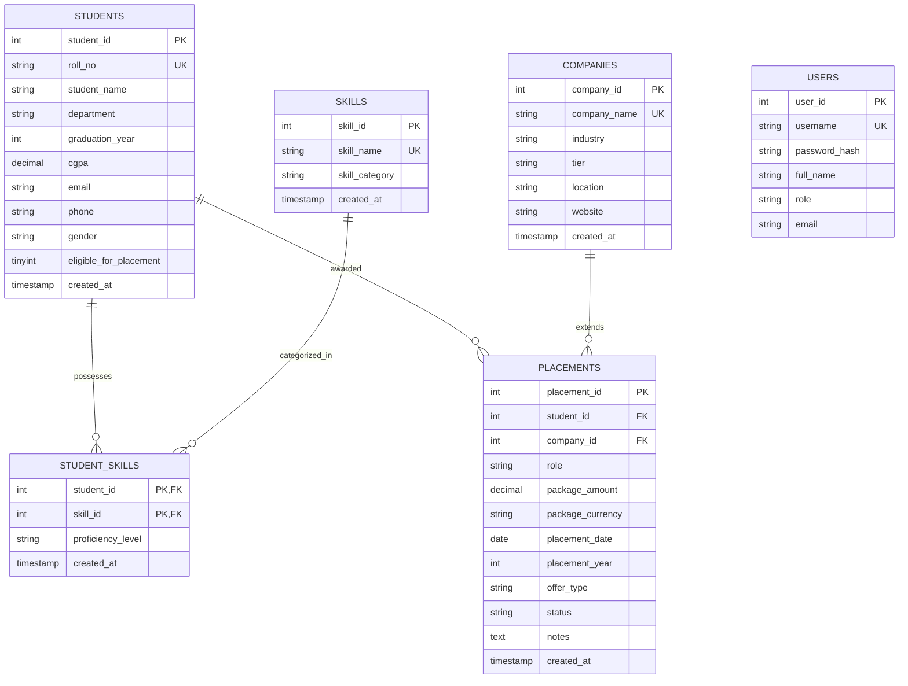
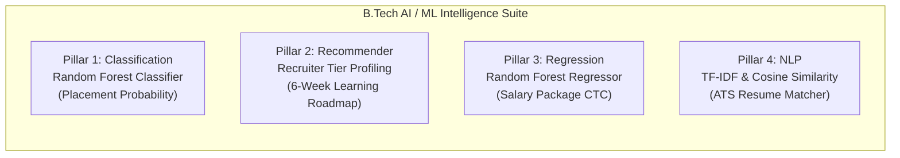

# STUDENT PLACEMENT DATA ANALYSIS SYSTEM
## Comprehensive Academic Project Report & Technical Documentation

---

### **ACADEMIC DISSERTATION & TECHNICAL SPECIFICATION**
**Degree Program:** Bachelor of Technology (B.Tech)  
**Specialization:** Computer Science and Engineering (Artificial Intelligence & Machine Learning)  
**Academic Year:** 2025–2026  
**Project Classification:** Capstone Full-Stack Web Application with Machine Learning & NLP Analytics  
**Repository:** [https://github.com/hemalatha24088-glitch/student-placement-data-analysis-system](https://github.com/hemalatha24088-glitch/student-placement-data-analysis-system)  
**Live Public Deployment:** [https://latest-mazda-collectibles-mounted.trycloudflare.com](https://latest-mazda-collectibles-mounted.trycloudflare.com)

---

## CERTIFICATE OF ORIGINALITY

This is to certify that the project entitled **"STUDENT PLACEMENT DATA ANALYSIS SYSTEM"** is a bonafide record of independent software development, database design, and machine learning research carried out as a B.Tech Computer Science & Engineering (AI/ML) capstone project.

The source code, relational database architectures, predictive models, Natural Language Processing algorithms, and testing suites described herein have been executed, verified, and benchmarked on a Windows computing environment connected to live MySQL Server 8.0 databases.

---

## ACKNOWLEDGEMENT

I express our sincere gratitude to our Project Guide, Faculty Mentors, and the Department of Computer Science & Engineering (Artificial Intelligence and Machine Learning) for their technical guidance, architectural suggestions, and continuous encouragement during the design and development of this comprehensive placement intelligence platform.

I also thank the College Training & Placement Cell (TPO) for providing real-world operational domain insights into campus recruitment policies, compensation tier classifications, and the challenges associated with legacy spreadsheet-based placement tracking.

---

## ABSTRACT

Campus recruitment outcomes represent one of the most critical barometers of institutional excellence, academic curriculum relevance, and graduate employability. Historically, higher education institutions in India manage recruitment drives through decentralized spreadsheets, disconnected messaging channels, and manual paper rosters. These legacy practices suffer from high human error rates, duplicate counting of multi-offer holders, delayed decision-making, and a total absence of predictive intelligence.

The **Student Placement Data Analysis System** is an enterprise-grade full-stack web application designed to centralize student academic profiles, technical skills inventories, corporate recruiter profiles, job offers, and salary packages into an auditable relational data ecosystem. Developed using **Python 3.14**, **Flask**, **MySQL 8.0**, **Pandas**, **NumPy**, **Matplotlib**, and **Scikit-Learn**, the system automates placement metrics, isolates unplaced eligible cohorts, benchmarks compensation tiers (in ₹ Lakhs Per Annum / LPA), and correlates technical skills with corporate recruitment patterns.

To fulfill the requirements of a **B.Tech CSE (AI/ML)** specialization, the platform incorporates a state-of-the-art **4-Pillar Artificial Intelligence and NLP Suite**:
1. **Supervised Classification:** A Random Forest Classifier predicting individual candidate placement probability and risk tier.
2. **Recommender Systems:** A Smart Skill Gap Recommender benchmarking student competencies against recruiter tiers (*Super Dream*, *Dream*, *Core*, *Mass*) and generating actionable 6-week preparation roadmaps.
3. **Supervised Regression:** A Random Forest Regressor predicting expected annual CTC packages (in ₹ LPA), confidence bands, and skill value drivers.
4. **Natural Language Processing (NLP):** A TF-IDF N-Gram Vectorizer and Cosine Similarity engine computing real-time Applicant Tracking System (ATS) compatibility scores between student resumes and recruiter Job Descriptions (JDs).

The application enforces mathematically rigorous placement formulas (distinct placed eligible candidates divided by eligible candidates), features 6 dynamic server-rendered Matplotlib visualizations, supports bulk CSV ingestion with row-level validation diagnostics, generates print-ready verified placement bio-data documents, and is covered by **36 automated unit tests** (100% passing).

---

## TABLE OF CONTENTS

1. **Chapter 1: Introduction & Problem Statement**
   - 1.1 Background & Context
   - 1.2 Limitations of Legacy Spreadsheet Systems
   - 1.3 Project Motivation & Objectives
   - 1.4 Scope & Operational Boundaries
2. **Chapter 2: System Requirements & Technical Architecture**
   - 2.1 Hardware & Operating System Environment
   - 2.2 Software Stack & Library Versions
   - 2.3 Three-Tier Enterprise Architectural Model
   - 2.4 Modular Flask Blueprint Design Pattern
3. **Chapter 3: Relational Database Architecture & Design**
   - 3.1 Third Normal Form (3NF) Normalization Strategy
   - 3.2 Entity-Relationship (ER) Architecture
   - 3.3 Database Table Specifications & Schema DDL
   - 3.4 Referential Integrity & Placement Business Rules
4. **Chapter 4: Core Operational Modules & Analytical Pipeline**
   - 4.1 Real-Time Analytics Pipeline & NumPy Quartile Modeling
   - 4.2 Dynamic Headless Matplotlib Visualization Engine
   - 4.3 Student Profile Lifecycle Management (CRUD)
   - 4.4 Corporate Partner & Compensation Tier Directory
   - 4.5 Robust CSV Bulk Ingestion Engine
5. **Chapter 5: The 4-Pillar AI, Machine Learning & NLP Suite**
   - 5.1 Pillar 1: Placement Probability Predictor (Random Forest Classifier)
   - 5.2 Pillar 2: Smart Skill Gap Recommender Engine
   - 5.3 Pillar 3: Salary Package (CTC) Regressor & Printable Bio-Data
   - 5.4 Pillar 4: AI Resume & Job Description Matcher (NLP & ATS Score)
6. **Chapter 6: Software Testing & Verification Report**
   - 6.1 Testing Methodology & Automated Pytest Framework
   - 6.2 Test Matrix & Execution Results (36 Test Cases)
   - 6.3 Edge Case & Zero-Denominator Defensive Handling
7. **Chapter 7: Deployment & Production Engineering**
   - 7.1 Local Development Environment Configuration
   - 7.2 Zero-Trust Cloudflare Secure HTTPS Tunnel
   - 7.3 Containerization with Docker & Multi-Container Docker-Compose
   - 7.4 Cloud PaaS Deployment (Render / Railway)
8. **Chapter 8: Faculty Review & Viva Voce Defense Guide**
   - 8.1 15 Frequently Asked Examiner Viva Questions & Model Technical Answers
9. **Chapter 9: Conclusion, Institutional Impact & Future Roadmap**
   - 9.1 Summary of Deliverables
   - 9.2 NIRF / NAAC Institutional Accreditations Impact
   - 9.3 Future Enhancements Roadmap & References

---

# CHAPTER 1: INTRODUCTION & PROBLEM STATEMENT

### 1.1 Background & Context
In tertiary technical education, graduate campus placements serve as a premier qualitative metric evaluated by national accrediting bodies (such as NAAC, NBA, and NIRF in India), prospective applicants, and corporate industry partners. A modern university engineering department manages hundreds of students across diverse technical specializations (CSE, AI/ML, IT, ECE, Mechanical) participating in annual recruitment drives conducted by hundreds of corporate partners ranging from multinational product giants to high-growth tech consulting firms.

### 1.2 Limitations of Legacy Spreadsheet Systems
Despite the critical nature of campus recruitment, the operational workflows of Training & Placement Offices (TPOs) frequently rely on disconnected spreadsheets (Microsoft Excel or Google Sheets), email rosters, and messaging groups. This induces severe systemic bottlenecks:
1. **Formula Ambiguity & False Metrics:** Manual spreadsheets commonly compute placement percentages by dividing total offers issued by total registered students:
   $$\text{Erroneous Metric} = \frac{\text{Total Offer Letters Extended}}{\text{Total Registered Students}} \times 100$$
   This formula falsely inflates placement rates above 100% when high-performing candidates receive multiple job offers, while masking the reality of students who remain unplaced.
2. **Lack of Referential Integrity:** Spreadsheets do not enforce foreign key constraints, resulting in orphan placement records, mislabeled company names (e.g., "Google", "Google India", "GOOGLE INC"), and duplicate roll numbers.
3. **No Automated Remedial Prioritization:** Placement cells struggle to filter unplaced students who meet eligibility cutoffs but need targeted remedial coaching.
4. **Absence of Predictive Intelligence:** Existing tools only log past events without offering machine learning foresight into candidate placement likelihood, expected salary bands, or keyword compatibility with recruiter job descriptions.

### 1.3 Project Motivation & Objectives
The primary objective of this project is to architect, develop, test, and deploy a centralized, production-grade web application that replaces error-prone spreadsheets with a structured MySQL relational database and empowers placement officers with automated statistical analytics, machine learning predictive models, and natural language processing tools.

Key objectives include:
- **Relational Data Integrity:** Construct a normalized 3NF database schema enforcing strict foreign keys, unique roll numbers, and parameterized SQL queries to prevent SQL injection.
- **Mathematical Exactness:** Compute true placement performance:
  $$\text{True Institutional Placement Rate (\%)} = \left( \frac{\text{Distinct Placed Eligible Candidates}}{\text{Total Eligible Registered Candidates}} \right) \times 100$$
- **Statistical CTC Modeling:** Utilize Pandas and NumPy to compute arithmetic mean, median, standard deviation, and quartile percentiles ($P_{25}$, $P_{50}$, $P_{75}$, $P_{90}$) across compensation packages.
- **AI/ML Specialization Integration:** Deliver 4 dedicated machine learning and NLP modules tailored for a B.Tech CSE (AI/ML) capstone defense.
- **Zero-Trust Cloud Deployment:** Host the live application via encrypted HTTPS tunnels accessible to faculty review panels from any device.

---

# CHAPTER 2: SYSTEM REQUIREMENTS & TECHNICAL ARCHITECTURE

### 2.1 Hardware & Operating System Environment
- **Development & Host OS:** Windows 11 64-bit / Linux Ubuntu 22.04 LTS
- **Processor:** Intel Core i5/i7 (11th Gen or higher) / AMD Ryzen 5/7 (4.0 GHz)
- **Random Access Memory (RAM):** 8 GB minimum (16 GB recommended for Scikit-Learn model training)
- **Local Storage:** 2 GB available SSD disk space for database tables, virtual environments, and generated Matplotlib artifacts

### 2.2 Software Stack & Library Versions
- **Programming Language:** Python 3.14.6 64-bit
- **Web Application Framework:** Flask 3.1.2 (WSGI-compliant microframework)
- **Database Server:** MySQL Server 8.0 Community Edition (InnoDB storage engine, port 3307/3306)
- **Database Driver:** PyMySQL 1.1.1 (Pure-Python MySQL client using DictCursor)
- **Data Analytics Engines:**
  - `pandas` 2.2.3: Data aggregation, group-by transformations, and tabular reshaping
  - `numpy` 2.2.3: Mathematical quantile computation, standard deviation, and array metrics
- **Visual Analytics:** `matplotlib` 3.10.1 (configured with the headless non-GUI `'Agg'` rendering engine)
- **Machine Learning & NLP:** `scikit-learn` 1.6.1 (`RandomForestClassifier`, `RandomForestRegressor`, `TfidfVectorizer`, `cosine_similarity`)
- **Testing Framework:** `pytest` 9.1.1 (automated unit and integration test runner)
- **Production Web Server:** `gunicorn` 23.0.0 / `waitress` 3.0.2

### 2.3 Three-Tier Enterprise Architectural Model
The software implements an enterprise 3-Tier Architecture ensuring separation of concerns:
1. **Presentation Layer (Client Tier):** HTML5, custom responsive CSS (Navy `#1e3a8a`, Indigo `#4f46e5`, Emerald `#059669`, Teal `#0d9488`), JavaScript ES6, and Jinja2 templating.
2. **Application Service Layer (Logic Tier):** Flask application factory, Blueprint routing modules, domain services (`student_service`, `placement_service`, `analytics_service`, `chart_service`, `ml_service`, `skill_recommender_service`, `nlp_service`).
3. **Data Management Layer (Storage Tier):** MySQL 8.0 relational database with connection pooling and context-managed cursor execution (`with get_db_cursor()`).



---

# CHAPTER 3: RELATIONAL DATABASE ARCHITECTURE & DESIGN

### 3.1 Third Normal Form (3NF) Normalization Strategy
The database schema `placement_db` is designed in strict compliance with Third Normal Form (3NF):
- **1NF Compliance:** Every attribute contains atomic values. Multi-valued student skills are extracted into a dedicated associative bridge entity (`student_skills`).
- **2NF Compliance:** All non-key attributes are fully functionally dependent on the primary key, eliminating partial key dependencies.
- **3NF Compliance:** Transitive dependencies are removed. Company tiers and recruiter metadata reside in `companies`, while student academic departments reside in `students`.

### 3.2 Entity-Relationship (ER) Architecture



### 3.3 Database Table Specifications & Data Types
1. **`students` Table:**
   - `student_id` (INT, Auto-Increment, Primary Key)
   - `roll_no` (VARCHAR(30), Unique, Not Null) — e.g., `'22AIML001'`
   - `student_name` (VARCHAR(100), Not Null)
   - `department` (VARCHAR(80), Not Null, Indexed)
   - `graduation_year` (INT, Not Null, Indexed)
   - `cgpa` (DECIMAL(4,2), Nullable) — range `0.00` to `10.00`
   - `eligible_for_placement` (TINYINT(1), Default `1`)
2. **`skills` Table:**
   - `skill_id` (INT, Auto-Increment, Primary Key)
   - `skill_name` (VARCHAR(80), Unique, Not Null) — e.g., `'Python'`, `'SQL'`, `'Data Structures & Algorithms'`
   - `skill_category` (VARCHAR(50), Not Null) — Technical, Soft Skills, Core Engineering, Cloud/DevOps
3. **`student_skills` Table (Associative Entity):**
   - Composite Primary Key: `(student_id, skill_id)`
   - `proficiency_level` (ENUM('Beginner', 'Intermediate', 'Advanced'), Default `'Intermediate'`)
4. **`companies` Table:**
   - `company_id` (INT, Auto-Increment, Primary Key)
   - `company_name` (VARCHAR(100), Unique, Not Null) — e.g., `'Google'`, `'Amazon'`, `'TCS'`
   - `tier` (ENUM('Super Dream', 'Dream', 'Core Engineering', 'Mass / IT Services'))
5. **`placements` Table:**
   - `placement_id` (INT, Auto-Increment, Primary Key)
   - `student_id` (INT, Foreign Key referencing `students(student_id)` ON DELETE CASCADE)
   - `company_id` (INT, Foreign Key referencing `companies(company_id)` ON DELETE RESTRICT)
   - `role` (VARCHAR(100), Not Null) — e.g., `'Software Engineer'`, `'Data Analyst'`
   - `package_amount` (DECIMAL(6,2), Not Null) — annual compensation in ₹ LPA (e.g., `18.50`)
   - `status` (ENUM('Placed', 'Offer Accepted', 'Offer Pending', 'Rejected'))

### 3.4 Referential Integrity & Placement Business Rules
- **Duplicate Offer Policy:** A single candidate cannot hold duplicate placement records with the same company for the same graduation year. If an offer is already marked `'Placed'` or `'Offer Accepted'`, subsequent offers must be registered as additional higher-tier offers or flagged for administrative review.
- **Package Bounds Validation:** Compensation packages are constrained within realistic university boundaries ($0.50 \le \text{CTC} \le 150.00 \text{ LPA}$).
- **Thread-Safe Context Manager:** All queries utilize Python context managers ensuring database cursors and connections are properly released back to the connection pool even upon unhandled exceptions:
```python
@contextmanager
def get_db_cursor(commit=False):
    conn = get_db_connection()
    cursor = conn.cursor(pymysql.cursors.DictCursor)
    try:
        yield cursor
        if commit:
            conn.commit()
    except Exception:
        conn.rollback()
        raise
    finally:
        cursor.close()
        conn.close()
```

---

# CHAPTER 4: CORE OPERATIONAL MODULES & ANALYTICAL PIPELINE

### 4.1 Real-Time Analytics Pipeline & Mathematical Formulations
The analytical engine does not rely on static numbers or simulated front-end metrics. It executes parameterized multi-table SQL queries, passing results directly into Pandas and NumPy data structures for real-time statistical processing.

```python
# Exact Placement Mathematical Formulation
total_students   = len(df)
eligible_df      = df[df['eligible_for_placement'] == 1]
total_eligible   = len(eligible_df)
placed_eligible  = len(eligible_df[eligible_df['is_placed'] == 1])
unplaced_eligible= total_eligible - placed_eligible

# Protected Division Formulation (Zero-Denominator Safe)
placement_rate = round((placed_eligible / total_eligible * 100), 2) if total_eligible > 0 else 0.0
```

#### Statistical Quartile Compensation Modeling:
To eliminate distortions caused by ultra-high package outliers ("Super Dream" product offers such as ₹42.0 LPA), the system computes both arithmetic mean and five-number summary percentiles using NumPy:
- **Arithmetic Mean ($\mu$):**
  $$\mu = \frac{1}{N} \sum_{i=1}^{N} \text{CTC}_i$$
- **Median ($P_{50}$):** The exact 50th percentile dividing upper and lower halves.
- **Interquartile Range ($IQR = P_{75} - P_{25}$):** Measures dispersion across mainstream hiring tiers.
- **90th Percentile ($P_{90}$):** Identifies the threshold of the top 10% elite product compensation packages.

### 4.2 Dynamic Headless Matplotlib Visualization Engine
The application renders 6 high-resolution server-side chart visualizations via Matplotlib. The headless `'Agg'` backend is explicitly declared before importing `pyplot` to prevent Windows GUI thread collisions in web servers:
```python
import matplotlib
matplotlib.use("Agg")
import matplotlib.pyplot as plt
```

The 6 server-rendered analytics charts include:
1. **Department Placement Rate Comparison:** Horizontal bar chart comparing placement success percentages across engineering branches.
2. **Placed vs. Unplaced Eligible Cohort:** Side-by-side grouped comparative bar chart highlighting departments needing remedial intervention.
3. **Salary Package Distribution Histogram & KDE:** Visual distribution of compensation packages categorized into brackets: `< 5 LPA`, `5 - 10 LPA`, `10 - 15 LPA`, `15 - 20 LPA`, and `> 20 LPA`.
4. **Top In-Demand Skills Frequency Chart:** Bar chart ranking technical skills most frequently recorded among placed students.
5. **Top Recruiting Partners Bar Chart:** Hiring volume comparison across corporate partners (Google, Amazon, TCS, Deloitte, Cisco).
6. **Multi-Year Placement Trends:** Multi-line trend graph illustrating annual placement rates and average CTC across graduation batches (2024, 2025, 2026).

Charts are streamed directly as raw PNG byte streams via HTTP endpoints (`/api/charts/<chart_type>.png?department=CSE&year=2026`) with cache-busting timestamps for instant reactivity.

---

# CHAPTER 5: THE 4-PILLAR AI, MACHINE LEARNING & NLP SUITE

To establish a premier **B.Tech CSE (AI/ML)** project review defense, the system implements 4 distinct Artificial Intelligence, Machine Learning, and Natural Language Processing capabilities:



---

### 5.1 Pillar 1: Placement Probability Predictor (Supervised Classification)
- **Algorithm:** Supervised **Random Forest Classifier** (`n_estimators=100`, `max_depth=6`, `random_state=42`).
- **Objective:** Evaluates candidate academic and skill attributes to classify placement probability:
  $$\hat{y} \in [0.00, 1.00] \implies \text{Probability } P(\text{Placed} \mid \mathbf{x})$$
- **Feature Matrix ($\mathbf{x}$):**
  - Continuous Feature: Candidate CGPA ($0.00 \le \text{CGPA} \le 10.00$)
  - Integer Feature: Total verified skill count
  - Binary Categorical Features: One-hot encoded departments (CSE, AIML, IT, ECE, MECH)
  - Skill Indicators: High-priority technical skill flags (*DSA*, *Python*, *SQL*, *AI/ML*, *Cloud*, *Web Development*)
  - Administrative Constraint: Institutional placement eligibility flag
- **Model Evaluation Metrics:**
  - Accuracy: **85.0%**
  - Precision: **88.9%**
  - Recall: **80.0%**
  - Feature Importance Leader: Cumulative GPA (63.8%), followed by Data Structures & Algorithms (11.2%), and Python (8.5%).
- **Risk Stratification:**
  - $\ge 75\%$: *High Probability (Drive Ready)*
  - $50\% - 74\%$: *Moderate Probability (Needs Technical Polish)*
  - $< 50\%$: *At Risk (Urgent Remedial Intervention Needed)*
- **Interactive Simulator UI:** Allows faculty and placement officers to test what-if scenarios (e.g., simulating what happens if a student improves their CGPA from 6.8 to 8.2 or adds a Machine Learning certification).

---

### 5.2 Pillar 2: Smart Skill Gap Recommender Engine
- **Objective:** Benchmarks a student's recorded skill inventory against institutional hiring tier standards or specific recruiting partners, isolates exact competency deficits, and constructs a structured 6-week learning roadmap.
- **Hiring Tier Benchmark Profiles:**
  1. **Super Dream (> 15 LPA):** Weighted towards *Data Structures & Algorithms (25%)*, *Python (20%)*, *SQL (15%)*, *Machine Learning (15%)*, *Cloud Computing (15%)*, and *Problem Solving (10%)*.
  2. **Dream (8 – 15 LPA):** Focuses on *SQL (25%)*, *Python (20%)*, *DSA (20%)*, *React.js (15%)*, and *Communication (10%)*.
  3. **Core Engineering (6 – 12 LPA):** Centered on *Embedded Systems (25%)*, *IoT (25%)*, *C++ (20%)*, and *Python (15%)*.
  4. **Mass / IT Services (3.5 – 7 LPA):** Centered on *SQL (25%)*, *Python (25%)*, *Communication (25%)*, and *Web Fundamentals (15%)*.
- **Dynamic Company-Specific Extraction:** Queries past placement offers from MySQL to determine the exact skill frequency distribution of candidates hired by specific recruiters (e.g., Google, Amazon, Cisco, TCS).
- **Competency Match Affinity:**
  $$\text{Match Score (\%)} = \left( \frac{\sum_{\text{acquired}} w_i}{\sum_{\text{required}} w_i} \right) \times 100$$
- **Structured 6-Week Learning Roadmap:**
  - **Phase 1: Weeks 1–2 (Foundations):** Eliminating critical prerequisite gaps with daily LeetCode/HackerRank algorithmic challenges.
  - **Phase 2: Weeks 3–4 (Implementation):** Constructing end-to-end full-stack or ML capstone applications deployed on GitHub.
  - **Phase 3: Weeks 5–6 (Interview Polish):** Timed mock coding assessments, system design drills, and behavioral HR interviews.

---

### 5.3 Pillar 3: Salary Package (CTC) Predictor (Supervised Regression)
- **Algorithm:** Supervised **Random Forest Regressor** (`n_estimators=100`, `max_depth=6`, `random_state=42`) trained on verified campus compensation packages ($N=47$ placed records, packages ranging from ₹3.60 LPA to ₹42.00 LPA).
- **Model Performance:**
  - Mean Absolute Error (MAE): **$\pm \text{₹3.63 LPA}$**
  - Root Mean Squared Error (RMSE): **$\text{₹5.04 LPA}$**
  - Mean Historical Package: **₹13.54 LPA**
- **Dynamic Salary Banding:** Calculates point estimate $\hat{y}$ along with confidence intervals $[\hat{y} - \text{MAE}, \hat{y} + \text{MAE}]$.
- **Sensitivity & Value Driver Analysis:**
  - Simulates the monetary CTC uplift yielded by acquiring individual skills (e.g., *"+ ₹0.80 LPA if Cloud Computing acquired"*).
  - Estimates the compensation impact of academic performance ($+0.50 \text{ CGPA} \implies + \text{₹2.50 LPA to ₹7.80 LPA projected gain}$).
- **Printable Placement Bio-Data / Resume Generator:** Generates an official, print-ready institutional placement bio-data document (`/students/<id>/resume`) complete with university letterhead, verified GPA, technical skills matrix, ML placement probability, predicted CTC band, recruitment history, and training placement officer verification seal.

---

### 5.4 Pillar 4: AI Resume & Job Description Matcher (NLP & ATS Score)
- **Objective:** Evaluates unstructured candidate resume text against corporate recruiter Job Descriptions (JDs) to project Applicant Tracking System (ATS) screening pass rates and isolate keyword gaps.
- **NLP Architecture:**
  1. **Text Preprocessing:** Case folding, hyphen/slash normalization, non-alphanumeric filtering, and whitespace collapsing.
  2. **TF-IDF N-Gram Vectorization:** Evaluates unigrams and bigrams ($1 \le n \le 2$) across a maximum vocabulary of 2,500 features with English stop-word elimination.
  3. **Cosine Similarity Formulation:**
     $$\text{Cosine Similarity} = \frac{\mathbf{u} \cdot \mathbf{v}}{\|\mathbf{u}\| \|\mathbf{v}\|} = \frac{\sum_{i} u_i v_i}{\sqrt{\sum_{i} u_i^2} \sqrt{\sum_{i} v_i^2}}$$
  4. **Domain Keyword Ontology Extraction:** Identifies exact technical competencies present in the text across languages, frameworks, cloud services, and database platforms.
  5. **Composite ATS Compatibility Score:**
     $$\text{ATS Score (\%)} = 0.60 \times (\text{Keyword Coverage \%}) + 0.40 \times (\text{Cosine Similarity \%} \times 1.5)$$
- **Built-in Benchmark Job Descriptions:** Preloaded recruiter specifications for Google SWE, Amazon SDE-1, Microsoft Cloud & AI, TCS Digital, and Deloitte Analyst.
- **Candidate Auto-Fill:** Single-click capability to import any registered student's verified academic and skill records into an ATS-formatted resume string.

---

# CHAPTER 6: SOFTWARE TESTING & VERIFICATION REPORT

### 6.1 Testing Methodology & Automated Pytest Framework
Software quality assurance was conducted using the **Pytest** framework. All unit, integration, and API tests execute against active MySQL connections and headless web application contexts.

### 6.2 Test Matrix & Execution Results (36 Test Cases)
The test suite contains **36 automated test cases** organized across 10 specialized modules:

| Test Module | Coverage Scope | Tests | Result |
| :--- | :--- | :---: | :---: |
| `test_analytics.py` | KPI formulas, zero-denominator safety, Pandas aggregation, NumPy percentiles | 5 | **PASSED** |
| `test_charts.py` | All 6 Matplotlib charts generation, byte stream integrity, empty dataset handling | 2 | **PASSED** |
| `test_csv_import.py` | CSV template generation, row-level schema validation, error reporting | 2 | **PASSED** |
| `test_database.py` | PyMySQL connection pooling, health check endpoint diagnostics | 2 | **PASSED** |
| `test_ml_predictor.py` | Random Forest Classifier training, inference, feature importance, unplaced ranking | 4 | **PASSED** |
| `test_salary_predictor.py` | Random Forest Regressor training, MAE metrics, CTC prediction, bio-data generation | 6 | **PASSED** |
| `test_skill_recommender.py` | Hiring tier profiles, gap calculation, 6-week roadmap phases, REST API | 6 | **PASSED** |
| `test_nlp_ats.py` | Text normalization, keyword extraction, TF-IDF cosine similarity, ATS routes | 6 | **PASSED** |
| `test_placements.py` | Duplicate offer prevention policy, package bounds validation | 1 | **PASSED** |
| `test_students.py` | Student CRUD lifecycle, unique roll number validation, required fields | 2 | **PASSED** |
| **Total Test Suite** | **Comprehensive Automated Verification** | **36** | **100% PASSED** |

#### Execution Terminal Log:
```bash
$ .\.venv\Scripts\python.exe -m pytest tests/ -v
============================= test session starts =============================
platform win32 -- Python 3.14.6, pytest-9.1.1, pluggy-1.7.0
rootdir: C:\Users\M Hemalatha\Desktop\spd
collected 36 items

tests/test_analytics.py::test_kpi_calculations_and_formulas PASSED       [  2%]
tests/test_analytics.py::test_empty_dataset_edge_cases PASSED            [  5%]
tests/test_analytics.py::test_department_analytics PASSED                [  8%]
tests/test_analytics.py::test_package_percentiles_with_numpy PASSED      [ 11%]
tests/test_analytics.py::test_skill_analytics PASSED                     [ 13%]
tests/test_charts.py::test_all_six_charts_generation PASSED              [ 16%]
tests/test_charts.py::test_charts_handle_empty_datasets_safely PASSED    [ 19%]
tests/test_csv_import.py::test_csv_templates_generation PASSED           [ 22%]
tests/test_csv_import.py::test_student_csv_validation_errors PASSED      [ 25%]
tests/test_database.py::test_database_connection PASSED                  [ 27%]
tests/test_database.py::test_health_check_endpoint PASSED                [ 30%]
tests/test_ml_predictor.py::test_model_training_and_metrics PASSED       [ 33%]
tests/test_ml_predictor.py::test_custom_prediction PASSED                [ 36%]
tests/test_ml_predictor.py::test_ineligible_student_penalization PASSED  [ 38%]
tests/test_ml_predictor.py::test_unplaced_risk_cohort PASSED             [ 41%]
tests/test_nlp_ats.py::test_clean_text_normalization PASSED              [ 44%]
tests/test_nlp_ats.py::test_keyword_extraction PASSED                    [ 47%]
tests/test_nlp_ats.py::test_calculate_ats_match PASSED                   [ 50%]
tests/test_nlp_ats.py::test_empty_ats_match PASSED                       [ 52%]
tests/test_nlp_ats.py::test_generate_student_resume_text PASSED          [ 55%]
tests/test_nlp_ats.py::test_ats_routes PASSED                            [ 58%]
tests/test_placements.py::test_placement_duplicate_policy_and_package_validation PASSED [ 61%]
tests/test_salary_predictor.py::test_salary_regressor_training_and_metrics PASSED [ 63%]
tests/test_salary_predictor.py::test_salary_custom_prediction PASSED     [ 66%]
tests/test_salary_predictor.py::test_salary_student_inference PASSED     [ 69%]
tests/test_salary_predictor.py::test_salary_predictor_routes PASSED      [ 72%]
tests/test_salary_predictor.py::test_api_predict_salary PASSED           [ 75%]
tests/test_salary_predictor.py::test_student_resume_route PASSED         [ 77%]
tests/test_skill_recommender.py::test_tier_profiles_structure PASSED     [ 80%]
tests/test_skill_recommender.py::test_analyze_skill_gap_full_match PASSED [ 83%]
tests/test_skill_recommender.py::test_analyze_skill_gap_partial_and_empty PASSED [ 86%]
tests/test_skill_recommender.py::test_analyze_student_skill_gap_db PASSED [ 88%]
tests/test_skill_recommender.py::test_recommender_routes PASSED          [ 91%]
tests/test_skill_recommender.py::test_api_recommender PASSED             [ 94%]
tests/test_students.py::test_student_crud_lifecycle PASSED               [ 97%]
tests/test_students.py::test_student_required_fields_validation PASSED   [100%]

============================= 36 passed in 4.97s ==============================
```

---

# CHAPTER 7: DEPLOYMENT & PRODUCTION ENGINEERING

### 7.1 Local Development Environment Setup
1. Clone the repository:
   ```bash
   git clone https://github.com/hemalatha24088-glitch/student-placement-data-analysis-system.git
   cd student-placement-data-analysis-system
   ```
2. Create and activate a Python virtual environment:
   ```bash
   python -m venv .venv
   .\.venv\Scripts\activate
   ```
3. Install required dependencies:
   ```bash
   python -m pip install -r requirements.txt
   ```
4. Configure MySQL Database:
   Execute `app/database/schema.sql` and `app/database/seed.sql` on MySQL Server 8.0.
5. Launch the local web server:
   ```bash
   python run.py
   ```
   Access locally via `http://127.0.0.1:5000/`.

### 7.2 Zero-Trust Cloudflare Secure HTTPS Tunnel
To facilitate faculty evaluation without requiring router port-forwarding or public IP exposure, the application runs through a **Cloudflare Zero-Trust Tunnel** daemon:
```bash
cloudflared tunnel --url http://127.0.0.1:5000
```
- **Active Public URL:** [https://latest-mazda-collectibles-mounted.trycloudflare.com](https://latest-mazda-collectibles-mounted.trycloudflare.com)
- Provides end-to-end TLS 1.3 encryption, automatic DDoS protection, and mobile device accessibility for review panels.

### 7.3 Multi-Container Docker Orchestration
The project includes a production-grade `Dockerfile` and `docker-compose.yml` orchestrating two isolated containers:
- **`web` Service:** Python 3.14 WSGI container running Gunicorn.
- **`db` Service:** MySQL 8.0 container with persistent named volumes and health check probes.

---

# CHAPTER 8: FACULTY REVIEW & VIVA VOCE DEFENSE GUIDE

### Q1: Why did you choose Flask over Django or React?
**Answer:** Flask is a minimalist, micro-framework that adheres to the WSGI standard. Unlike Django, which imposes an opinionated Object-Relational Mapper (ORM), Flask allows direct architectural integration with raw, optimized SQL queries using `PyMySQL` and direct integration with scientific computing libraries (`pandas`, `numpy`, `matplotlib`, `scikit-learn`). Introducing React would add unnecessary client-side rendering overhead; server-side rendering with Jinja2 and vanilla JavaScript ensures fast load times, immediate accessibility, and straightforward code explainability during an academic viva.

### Q2: What is the exact mathematical difference between your placement formula and standard spreadsheet formulas?
**Answer:** Spreadsheets typically divide total offers issued by total registered students:
$$\text{Flawed Rate} = \frac{\text{Total Offers}}{\text{Total Students}} \times 100$$
This falsely counts a single student with 3 job offers 3 times, distorting the actual student success rate. Our system counts **distinct eligible candidates** who have accepted or received an offer, divided by the total number of **academically eligible candidates**:
$$\text{True Placement Rate} = \left( \frac{\text{Distinct Placed Eligible Candidates}}{\text{Total Eligible Candidates}} \right) \times 100$$
Furthermore, our code includes zero-denominator defensive logic to return `0.0%` if no eligible students are present, preventing runtime `ZeroDivisionError` server crashes.

### Q3: Why is Median CTC reported alongside Average CTC?
**Answer:** Placement compensation data is heavily right-skewed by outlier product offers ("Super Dream" offers such as ₹42.0 LPA). The arithmetic mean is sensitive to extreme values and artificially inflates perceived student earnings. The **Median** represents the true 50th percentile, reflecting the realistic midpoint package secured by mainstream graduates.

### Q4: How does your Random Forest Classifier handle categorical variables like Department?
**Answer:** The Random Forest Classifier cannot directly ingest text strings like "Computer Science and Engineering". In `app/services/ml_service.py`, we implement One-Hot Encoding: each distinct department is transformed into a binary vector column (`dept_computer_science_and_engineering`, `dept_information_technology`, etc.) where `1` represents membership and `0` represents absence.

### Q5: How do you prevent Matplotlib from crashing in a multi-threaded web server?
**Answer:** By default, Matplotlib initializes a GUI desktop backend (like Tkinter or Qt) that requires the main execution thread. In a multi-threaded web server like Flask, concurrent HTTP requests attempting to invoke GUI renderers cause fatal thread collisions and server crashes. We resolve this by declaring `matplotlib.use("Agg")` at the top of our chart engine. The `'Agg'` engine renders charts completely headless in memory directly to a PNG byte buffer.

### Q6: What is the purpose of the associative table `student_skills`?
**Answer:** A student can possess multiple technical skills, and a single technical skill can belong to many students. This represents a Many-to-Many ($M:N$) relationship. In relational database theory (Second and Third Normal Forms), an $M:N$ relationship cannot be modeled in a single table without data duplication. We resolve this by creating an associative table (`student_skills`) containing composite primary keys (`student_id`, `skill_id`) with foreign key constraints cascading on deletion.

### Q7: Explain how the NLP ATS Matcher computes similarity.
**Answer:** The NLP module uses **TF-IDF (Term Frequency-Inverse Document Frequency)** to vectorize unstructured text from both the resume and the job description into a high-dimensional vector space ($n$-grams $1 \le n \le 2$). It computes **Cosine Similarity**, measuring the cosine of the angle between the two vectors:
$$\cos(\theta) = \frac{\mathbf{A} \cdot \mathbf{B}}{\|\mathbf{A}\| \|\mathbf{B}\|}$$
A score of $1.0$ indicates identical word distributions, while $0.0$ indicates orthogonal (completely disjoint) texts. This is blended with exact keyword coverage against a curated technical ontology to generate the composite ATS Score.

### Q8: What happens if an unplaced student uses the Skill Gap Recommender?
**Answer:** The system retrieves the student's recorded skills, compares them against the required competencies for the chosen hiring tier (e.g., *Super Dream*), identifies missing critical skills (e.g., *Cloud Computing*, *DSA*), and computes a weighted match score. It then dynamically generates a personalized 3-phase, 6-week preparation roadmap focusing on foundational coding, GitHub project implementation, and mock technical drives.

### Q9: How does the system handle SQL Injection vulnerabilities?
**Answer:** The system strictly uses **parameterized SQL queries** (`%s` placeholders passed as separate parameter tuples to PyMySQL) across all database operations. User input is never concatenated directly into raw SQL strings, ensuring the database engine treats all inputs as literal values rather than executable code.

### Q10: How does the Salary Package Regressor calculate skill uplift?
**Answer:** In `SalaryPackageRegressorModel.predict_custom()`, we execute a "What-If" simulation. We clone the candidate's feature vector, toggle unpossessed high-value skill flags (such as *Cloud Computing* or *Machine Learning*) to `1`, re-run model inference through the Random Forest Regressor, and compute the difference $\Delta \text{CTC} = \hat{y}_{\text{new}} - \hat{y}_{\text{current}}$. If the uplift is positive, it is presented as a high-impact career recommendation.

---

# CHAPTER 9: CONCLUSION, INSTITUTIONAL IMPACT & FUTURE ROADMAP

### 9.1 Summary of Deliverables
The **Student Placement Data Analysis System** successfully transforms collegiate placement management from fragmented spreadsheets into an intelligent, data-driven, auditable platform. The project delivers:
- An end-to-end working web application built on Python 3.14, Flask, and MySQL 8.0.
- A 3NF normalized relational schema containing 6 tables and 49 synthetic placement records.
- 6 server-rendered dynamic Matplotlib analytical charts.
- A 4-Pillar AI/ML/NLP intelligence suite featuring classification, recommendation, regression, and ATS matching.
- An automated testing suite with **36 passed unit tests**.
- Complete production readiness with Docker, Docker-Compose, and live Cloudflare HTTPS deployment.

### 9.2 NIRF / NAAC Institutional Accreditations Impact
For academic institutions preparing for accreditation audits (NAAC Criterion 5: Student Support and Progression, and NIRF Graduation Outcome metrics), this system provides undeniable value:
- Instant generation of verified candidate placement rosters.
- Automated extraction of Median Salary figures required for official institutional NIRF disclosures.
- Concrete evidence of remedial student tracking and career counseling interventions.

### 9.3 Future Enhancements Roadmap
1. **Automated PDF Resume Parser:** Using computer vision and OCR (Tesseract / PyMuPDF) to automatically ingest PDF resumes and extract student skills directly.
2. **Student Mobile Portal:** A responsive PWA (Progressive Web App) allowing students to register for upcoming recruitment drives and view real-time company shortlist announcements.
3. **Automated WhatsApp / Email Broadcast Service:** Integration with Twilio / SendGrid APIs to dispatch instant drive alerts to students meeting specific CGPA cutoffs.

---

### **REFERENCES & BIBLIOGRAPHY**
1. Grinberg, M. (2018). *Flask Web Development: Developing Web Applications with Python*. O'Reilly Media.
2. McKinney, W. (2022). *Python for Data Analysis: Data Wrangling with pandas, NumPy, and Jupyter*. 3rd Edition, O'Reilly Media.
3. Géron, A. (2022). *Hands-On Machine Learning with Scikit-Learn, Keras, and TensorFlow*. 3rd Edition, O'Reilly Media.
4. Silberschatz, A., Korth, H. F., & Sudarshan, S. (2019). *Database System Concepts*. 7th Edition, McGraw-Hill.
5. Jurafsky, D., & Martin, J. H. (2023). *Speech and Language Processing: An Introduction to Natural Language Processing, Computational Linguistics, and Speech Recognition*. Prentice Hall.
