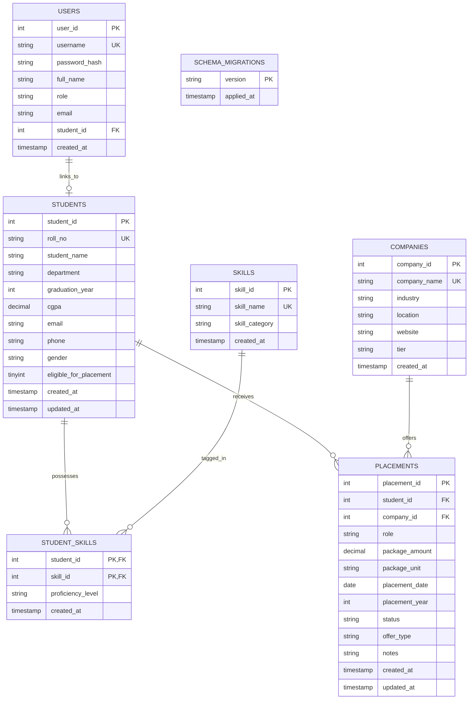

# Database Design Documentation
## Student Placement Data Analysis System
**Database Engine:** MySQL Server 8.0 (InnoDB)  
**Schema Name:** `placement_db`  
**Character Set:** `utf8mb4` &bull; **Collation:** `utf8mb4_unicode_ci`

---

### 1. Entity-Relationship (ER) Architecture

The database follows a normalized relational structure (3NF) designed to eliminate redundancy, optimize analytical query execution, and enforce strict referential integrity.



---

### 2. Table Specifications & Data Dictionary

#### 2.1 Table: `students`
Stores student academic credentials, demographic data, and placement eligibility status.
- **Primary Key:** `student_id` (INT AUTO_INCREMENT)
- **Unique Key:** `roll_no` (VARCHAR(50))
- **Indexes:** 
  - `idx_students_department`: Single index on `department`
  - `idx_students_grad_year`: Single index on `graduation_year`
  - `idx_students_dept_grad`: Composite index on `(department, graduation_year)`
  - `idx_students_eligibility`: Single index on `eligible_for_placement`
  - `idx_students_cgpa`: Single index on `cgpa`

| Column | Data Type | Nullable | Default | Description |
| :--- | :--- | :--- | :--- | :--- |
| `student_id` | INT | NO | AUTO_INCREMENT | Internal surrogate primary key |
| `roll_no` | VARCHAR(50) | NO | &mdash; | Unique university student roll number |
| `student_name` | VARCHAR(100) | NO | &mdash; | Full official name of student |
| `department` | VARCHAR(100) | NO | &mdash; | Branch of study (e.g., CSE, AI/ML, IT, ECE) |
| `graduation_year`| INT | NO | &mdash; | Academic batch year (e.g., 2024, 2025, 2026) |
| `cgpa` | DECIMAL(4, 2)| YES | NULL | Cumulative Grade Point Average (0.00–10.00) |
| `email` | VARCHAR(120)| YES | NULL | Institutional or personal email |
| `phone` | VARCHAR(20) | YES | NULL | Contact phone number |
| `gender` | VARCHAR(20) | YES | 'Other' | Gender identity classification |
| `eligible_for_placement` | TINYINT(1) | NO | 1 | Flag (1=Eligible, 0=Ineligible for placement drives) |
| `created_at` | TIMESTAMP | YES | CURRENT_TIMESTAMP | Record creation timestamp |
| `updated_at` | TIMESTAMP | YES | ON UPDATE CURRENT_TIMESTAMP | Record update timestamp |

---

#### 2.2 Table: `skills`
Master catalog of technical proficiencies, frameworks, and domain knowledge.
- **Primary Key:** `skill_id` (INT AUTO_INCREMENT)
- **Unique Key:** `skill_name` (VARCHAR(100))
- **Indexes:** `idx_skills_category` on `skill_category`

| Column | Data Type | Nullable | Default | Description |
| :--- | :--- | :--- | :--- | :--- |
| `skill_id` | INT | NO | AUTO_INCREMENT | Surrogate primary key |
| `skill_name` | VARCHAR(100) | NO | &mdash; | Official skill title (e.g., Python, SQL, Docker) |
| `skill_category` | VARCHAR(50) | NO | 'Technical' | Category (Programming, Web, Database, Cloud) |
| `created_at` | TIMESTAMP | YES | CURRENT_TIMESTAMP | Master record creation timestamp |

---

#### 2.3 Table: `student_skills`
Associative table resolving the many-to-many relationship between students and skills.
- **Primary Key:** Composite (`student_id`, `skill_id`)
- **Foreign Keys:**
  - `student_id` &rarr; `students.student_id` (ON DELETE CASCADE)
  - `skill_id` &rarr; `skills.skill_id` (ON DELETE CASCADE)
- **Indexes:** `idx_student_skills_skill` on `skill_id`

| Column | Data Type | Nullable | Default | Description |
| :--- | :--- | :--- | :--- | :--- |
| `student_id` | INT | NO | &mdash; | Reference to student |
| `skill_id` | INT | NO | &mdash; | Reference to master skill |
| `proficiency_level`| VARCHAR(30)| YES | 'Intermediate' | Beginner, Intermediate, or Advanced |
| `created_at` | TIMESTAMP | YES | CURRENT_TIMESTAMP | Association timestamp |

---

#### 2.4 Table: `companies`
Stores corporate partner profiles, recruitment sectors, and tier categories.
- **Primary Key:** `company_id` (INT AUTO_INCREMENT)
- **Unique Key:** `company_name` (VARCHAR(150))
- **Indexes:** `idx_companies_industry`, `idx_companies_tier`

| Column | Data Type | Nullable | Default | Description |
| :--- | :--- | :--- | :--- | :--- |
| `company_id` | INT | NO | AUTO_INCREMENT | Surrogate primary key |
| `company_name` | VARCHAR(150) | NO | &mdash; | Corporate organization name |
| `industry` | VARCHAR(100) | NO | 'Information Technology' | Sector (Product, IT Services, FinTech) |
| `location` | VARCHAR(100) | YES | 'India' | Headquarters / hiring hub |
| `website` | VARCHAR(200) | YES | NULL | Official careers URL |
| `tier` | VARCHAR(50) | YES | 'Core / Product' | Super Dream, Dream, Core, Mass |
| `created_at` | TIMESTAMP | YES | CURRENT_TIMESTAMP | Registration timestamp |

---

#### 2.5 Table: `placements`
Records individual job and internship offers extended to candidates.
- **Primary Key:** `placement_id` (INT AUTO_INCREMENT)
- **Foreign Keys:**
  - `student_id` &rarr; `students.student_id` (ON DELETE CASCADE)
  - `company_id` &rarr; `companies.company_id` (ON DELETE CASCADE)
- **Indexes:**
  - `idx_placements_status`: Single index on `status`
  - `idx_placements_year`: Single index on `placement_year`
  - `idx_placements_package`: Single index on `package_amount`
  - `idx_placements_role`: Single index on `role`
  - `idx_placements_comp_status`: Composite index on `(company_id, status)`
  - `idx_placements_student_status`: Composite index on `(student_id, status)`

| Column | Data Type | Nullable | Default | Description |
| :--- | :--- | :--- | :--- | :--- |
| `placement_id` | INT | NO | AUTO_INCREMENT | Surrogate primary key |
| `student_id` | INT | NO | &mdash; | Reference to candidate |
| `company_id` | INT | NO | &mdash; | Reference to recruiting company |
| `role` | VARCHAR(100) | NO | &mdash; | Job designation (e.g., Software Engineer) |
| `package_amount` | DECIMAL(6, 2)| NO | &mdash; | Annual CTC in LPA (INR) |
| `package_unit` | VARCHAR(20) | NO | 'LPA' | Currency unit convention |
| `placement_date` | DATE | NO | &mdash; | Official offer issuance date |
| `placement_year` | INT | NO | &mdash; | Placement drive academic year |
| `status` | VARCHAR(50) | NO | 'Placed' | Placed, Offer Accepted, Pending, Rejected |
| `offer_type` | VARCHAR(50) | YES | 'Full-time' | Full-time, Internship+PPO, Super Dream |
| `notes` | VARCHAR(255) | YES | NULL | Interview remarks or special conditions |
| `created_at` | TIMESTAMP | YES | CURRENT_TIMESTAMP | Record creation timestamp |
| `updated_at` | TIMESTAMP | YES | ON UPDATE CURRENT_TIMESTAMP | Record update timestamp |

---

#### 2.6 Table: `users`
Enforces user authentication, role-based access control (RBAC), and profile links.
- **Primary Key:** `user_id` (INT AUTO_INCREMENT)
- **Unique Key:** `username` (VARCHAR(50))
- **Foreign Key:** `student_id` &rarr; `students.student_id` (ON DELETE SET NULL)

| Column | Data Type | Nullable | Default | Description |
| :--- | :--- | :--- | :--- | :--- |
| `user_id` | INT | NO | AUTO_INCREMENT | Surrogate primary key |
| `username` | VARCHAR(50) | NO | &mdash; | Unique login username |
| `password_hash`| VARCHAR(255) | NO | &mdash; | Salted Werkzeug Scrypt/PBKDF2 hash |
| `full_name` | VARCHAR(100) | NO | &mdash; | User display name |
| `role` | VARCHAR(30) | NO | 'student' | Role: `student`, `placement_officer`, `admin` |
| `email` | VARCHAR(120) | YES | NULL | Contact email address |
| `student_id` | INT | YES | NULL | Link to corresponding student record (for students) |
| `created_at` | TIMESTAMP | YES | CURRENT_TIMESTAMP | Registration timestamp |

---

#### 2.7 Table: `schema_migrations`
Tracks database schema versioning and executed migration scripts.
- **Primary Key:** `version` (VARCHAR(50))

| Column | Data Type | Nullable | Default | Description |
| :--- | :--- | :--- | :--- | :--- |
| `version` | VARCHAR(50) | NO | &mdash; | Migration file identifier (e.g. `001_initial_schema`) |
| `applied_at` | TIMESTAMP | YES | CURRENT_TIMESTAMP | Execution timestamp |

---

### 3. Database Migrations & Version Control

Schema evolutions are managed idempotently through versioned SQL scripts in the `migrations/` directory:
- `migrations/001_initial_schema.sql`: Core baseline tables and foreign key constraints.
- `migrations/002_add_indexes_and_constraints.sql`: Composite performance indexes and optimization.

**Running Migrations:**
```bash
python migrations/migrate.py
```
The migration runner inspects `schema_migrations`, executes outstanding SQL scripts sequentially, catches duplicate index errors idempotently, and records applied versions.

---

### 4. Database Backup & Disaster Recovery

A reliable backup script is provided in `scripts/backup_db.py`:
```bash
# Creates a timestamped dump under backups/
python scripts/backup_db.py
```
Features:
- Prefers native `mysqldump` CLI when installed on the system host.
- Automatically falls back to a pure-Python schema and data extractor if `mysqldump` is unavailable.
- Outputs clean, restorable SQL dumps with transaction wraps.
