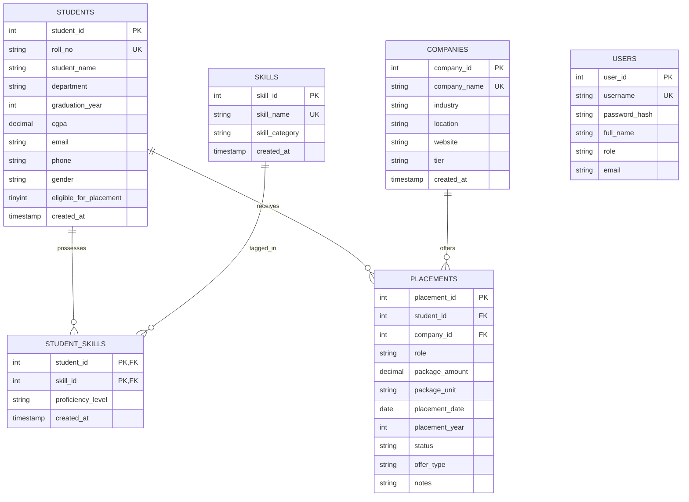

# Database Design Documentation
## Student Placement Data Analysis System
**Database Engine:** MySQL Server 8.0 (InnoDB)  
**Schema Name:** `placement_db`  
**Character Set:** `utf8mb4` &bull; **Collation:** `utf8mb4_unicode_ci`

---

### 1. Entity-Relationship (ER) Architecture

The database follows a normalized relational structure (3NF) designed to eliminate redundancy and maintain referential integrity.



---

### 2. Table Specifications & Data Dictionary

#### 2.1 Table: `students`
Stores core demographic, department, and academic credentials.
- **Primary Key:** `student_id` (INT AUTO_INCREMENT)
- **Unique Key:** `roll_no` (VARCHAR(50))
- **Indexes:** `idx_students_department`, `idx_students_grad_year`, `idx_students_eligibility`, `idx_students_cgpa`

| Column | Data Type | Nullable | Default | Description |
| :--- | :--- | :--- | :--- | :--- |
| `student_id` | INT | NO | AUTO_INCREMENT | Internal surrogate primary key |
| `roll_no` | VARCHAR(50) | NO | &mdash; | Unique university student roll number |
| `student_name` | VARCHAR(100) | NO | &mdash; | Full official name of student |
| `department` | VARCHAR(100) | NO | &mdash; | Branch of study (e.g. CSE, AI/ML, IT) |
| `graduation_year`| INT | NO | &mdash; | Academic batch year (e.g. 2026) |
| `cgpa` | DECIMAL(4, 2)| YES | NULL | Cumulative Grade Point Average (0.00–10.00) |
| `email` | VARCHAR(120)| YES | NULL | Institutional/personal email |
| `phone` | VARCHAR(20) | YES | NULL | Contact phone number |
| `gender` | VARCHAR(20) | YES | 'Other' | Gender classification |
| `eligible_for_placement` | TINYINT(1) | NO | 1 | Flag (1=Eligible, 0=Ineligible for drives) |
| `created_at` | TIMESTAMP | YES | CURRENT_TIMESTAMP | Record creation timestamp |
| `updated_at` | TIMESTAMP | YES | ON UPDATE CURRENT_TIMESTAMP | Record update timestamp |

---

#### 2.2 Table: `skills`
Master catalog of technical, programming, and soft skills evaluated in drives.
- **Primary Key:** `skill_id` (INT AUTO_INCREMENT)
- **Unique Key:** `skill_name` (VARCHAR(100))
- **Indexes:** `idx_skills_category`

| Column | Data Type | Nullable | Default | Description |
| :--- | :--- | :--- | :--- | :--- |
| `skill_id` | INT | NO | AUTO_INCREMENT | Surrogate primary key |
| `skill_name` | VARCHAR(100) | NO | &mdash; | Official skill title (e.g. Python, SQL) |
| `skill_category` | VARCHAR(50) | NO | 'Technical' | Classification (Programming, Core CS, AI, etc.) |
| `created_at` | TIMESTAMP | YES | CURRENT_TIMESTAMP | Timestamp of skill registration |

---

#### 2.3 Table: `student_skills`
Associative table resolving the many-to-many relationship between students and skills.
- **Primary Key:** Composite (`student_id`, `skill_id`)
- **Foreign Keys:**
  - `student_id` &rarr; `students.student_id` (ON DELETE CASCADE)
  - `skill_id` &rarr; `skills.skill_id` (ON DELETE CASCADE)

| Column | Data Type | Nullable | Default | Description |
| :--- | :--- | :--- | :--- | :--- |
| `student_id` | INT | NO | &mdash; | Reference to student |
| `skill_id` | INT | NO | &mdash; | Reference to master skill |
| `proficiency_level`| VARCHAR(30)| YES | 'Intermediate' | Beginner, Intermediate, or Advanced |
| `created_at` | TIMESTAMP | YES | CURRENT_TIMESTAMP | Association timestamp |

---

#### 2.4 Table: `companies`
Stores corporate partner profiles, recruitment sectors, and tier categories.
- **Primary Key:** `company_id` (INT AUTO_INCREMENT)
- **Unique Key:** `company_name` (VARCHAR(150))
- **Indexes:** `idx_companies_industry`, `idx_companies_tier`

| Column | Data Type | Nullable | Default | Description |
| :--- | :--- | :--- | :--- | :--- |
| `company_id` | INT | NO | AUTO_INCREMENT | Surrogate primary key |
| `company_name` | VARCHAR(150) | NO | &mdash; | Corporate organization name |
| `industry` | VARCHAR(100) | NO | 'Information Technology' | Sector (Product, IT Services, Core) |
| `location` | VARCHAR(100) | YES | 'India' | Headquarters / hiring hub |
| `website` | VARCHAR(200) | YES | NULL | Official careers URL |
| `tier` | VARCHAR(50) | YES | 'Core / Product' | Super Dream, Dream, Core, Mass |
| `created_at` | TIMESTAMP | YES | CURRENT_TIMESTAMP | Registration timestamp |

---

#### 2.5 Table: `placements`
Records individual job offers extended to students.
- **Primary Key:** `placement_id` (INT AUTO_INCREMENT)
- **Foreign Keys:**
  - `student_id` &rarr; `students.student_id` (ON DELETE CASCADE)
  - `company_id` &rarr; `companies.company_id` (ON DELETE CASCADE)
- **Indexes:** `idx_placements_status`, `idx_placements_year`, `idx_placements_package`, `idx_placements_role`

| Column | Data Type | Nullable | Default | Description |
| :--- | :--- | :--- | :--- | :--- |
| `placement_id` | INT | NO | AUTO_INCREMENT | Surrogate primary key |
| `student_id` | INT | NO | &mdash; | Reference to placed candidate |
| `company_id` | INT | NO | &mdash; | Reference to offering company |
| `role` | VARCHAR(100) | NO | &mdash; | Job designation (e.g. SDE-1, Data Analyst) |
| `package_amount` | DECIMAL(6, 2)| NO | &mdash; | Annual CTC numerical value in LPA (INR) |
| `package_unit` | VARCHAR(20) | NO | 'LPA' | Currency/unit convention (LPA CTC) |
| `placement_date` | DATE | NO | &mdash; | Official offer issuance date |
| `placement_year` | INT | NO | &mdash; | Placement drive academic year |
| `status` | VARCHAR(50) | NO | 'Placed' | Placed, Offer Accepted, Pending, Rejected |
| `offer_type` | VARCHAR(50) | YES | 'Full-time' | Full-time, Internship+PPO, Super Dream |
| `notes` | VARCHAR(255) | YES | NULL | Drive stage or recruitment remarks |
| `created_at` | TIMESTAMP | YES | CURRENT_TIMESTAMP | Record creation timestamp |
| `updated_at` | TIMESTAMP | YES | ON UPDATE CURRENT_TIMESTAMP | Record update timestamp |

---

#### 2.6 Table: `users`
Enables administrative authentication and role-based permissions.
- **Primary Key:** `user_id` (INT AUTO_INCREMENT)
- **Unique Key:** `username` (VARCHAR(50))

| Column | Data Type | Nullable | Default | Description |
| :--- | :--- | :--- | :--- | :--- |
| `user_id` | INT | NO | AUTO_INCREMENT | Surrogate primary key |
| `username` | VARCHAR(50) | NO | &mdash; | Login username |
| `password_hash`| VARCHAR(255) | NO | &mdash; | Salted Scrypt/PBKDF2 password hash |
| `full_name` | VARCHAR(100) | NO | &mdash; | Officer display name |
| `role` | VARCHAR(30) | NO | 'admin' | Role: admin, placement_officer |
| `email` | VARCHAR(120) | YES | NULL | Official contact email |
| `created_at` | TIMESTAMP | YES | CURRENT_TIMESTAMP | Registration timestamp |

---

### 3. Key Analytical SQL Queries

#### 3.1 Distinct Placed Candidates & Placement Rate
```sql
SELECT 
    COUNT(DISTINCT s.student_id) AS total_registered,
    COUNT(DISTINCT CASE WHEN s.eligible_for_placement = 1 THEN s.student_id END) AS total_eligible,
    COUNT(DISTINCT CASE WHEN s.eligible_for_placement = 1 AND p.status IN ('Placed', 'Offer Accepted') THEN s.student_id END) AS distinct_placed,
    ROUND(
        COUNT(DISTINCT CASE WHEN s.eligible_for_placement = 1 AND p.status IN ('Placed', 'Offer Accepted') THEN s.student_id END) * 100.0 /
        NULLIF(COUNT(DISTINCT CASE WHEN s.eligible_for_placement = 1 THEN s.student_id END), 0),
        2
    ) AS placement_rate_percentage
FROM students s
LEFT JOIN placements p ON s.student_id = p.student_id;
```

#### 3.2 Department Performance Aggregation
```sql
SELECT 
    s.department,
    COUNT(DISTINCT s.student_id) AS total_students,
    COUNT(DISTINCT CASE WHEN s.eligible_for_placement = 1 THEN s.student_id END) AS eligible_students,
    COUNT(DISTINCT CASE WHEN s.eligible_for_placement = 1 AND p.status IN ('Placed', 'Offer Accepted') THEN s.student_id END) AS placed_students,
    ROUND(
        COUNT(DISTINCT CASE WHEN s.eligible_for_placement = 1 AND p.status IN ('Placed', 'Offer Accepted') THEN s.student_id END) * 100.0 /
        NULLIF(COUNT(DISTINCT CASE WHEN s.eligible_for_placement = 1 THEN s.student_id END), 0),
        2
    ) AS placement_rate,
    ROUND(AVG(CASE WHEN p.status IN ('Placed', 'Offer Accepted') THEN p.package_amount END), 2) AS avg_package_lpa,
    MAX(CASE WHEN p.status IN ('Placed', 'Offer Accepted') THEN p.package_amount END) AS max_package_lpa
FROM students s
LEFT JOIN placements p ON s.student_id = p.student_id
GROUP BY s.department
ORDER BY placement_rate DESC;
```

#### 3.3 Skill Frequency Among Placed Candidates
```sql
SELECT 
    sk.skill_name,
    sk.skill_category,
    COUNT(DISTINCT ss.student_id) AS total_students_with_skill,
    COUNT(DISTINCT CASE WHEN p.status IN ('Placed', 'Offer Accepted') THEN ss.student_id END) AS placed_students_with_skill
FROM skills sk
JOIN student_skills ss ON sk.skill_id = ss.skill_id
JOIN students s ON ss.student_id = s.student_id
LEFT JOIN placements p ON s.student_id = p.student_id
GROUP BY sk.skill_id
ORDER BY placed_students_with_skill DESC;
```
